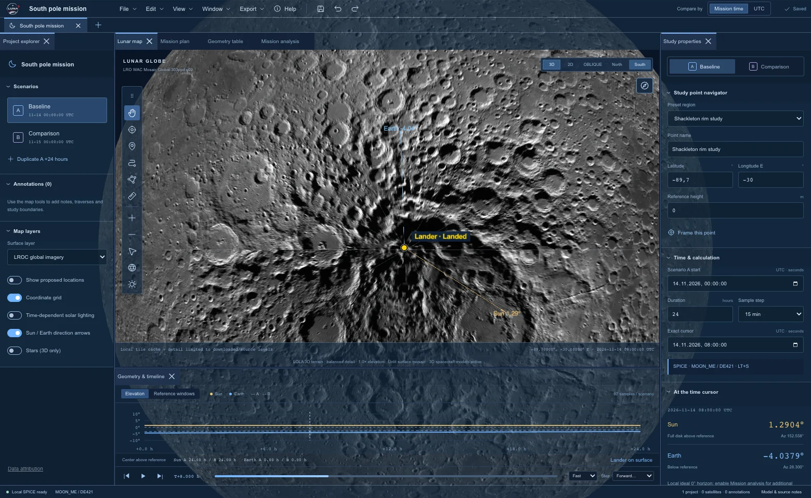

# LUNA — Lunar Landing Site Navigator

**What changes if a lunar landing slips by one day?** LUNA lets you compare sites and dates at the Moon’s south pole, see when sunlight and direct-to-Earth visibility overlap, and trace the difference to the geometry and terrain behind it.

[Watch the 30-second demo](https://youtu.be/8pRXoyf2IrE) · [Explore the project](https://luna.tutpro.org/) · [Science & sources](https://luna.tutpro.org/science.html) · [Space Apps submission](https://www.spaceappschallenge.org/2026/find-a-team/horizon90/?tab=project)



At the lunar south pole, a low Sun can disappear behind a ridge. Earth visibility is a separate constraint: a sunlit site may still lack a direct communication opportunity. LUNA puts the map, horizon, and timeline in one workspace so a student can see why, and a researcher can inspect the assumptions before shortlisting a site or date.

## Try a one-day delay

**Same site. Same hardware. A different window.** In this worked example at NASA’s LOLA Site04 study point, the reference chart looks favorable on both days: the Sun and Earth centers stay above the ideal horizontal plane. Once LUNA accounts for the sampled terrain horizon, the modeled solar array goes from generating about **11.1 kWh to 0 kWh**. Neither date yields a sampled access window to the selected Earth station, DSS-14.

| 24-hour study at Site04 | A · Nov 20, 2026 | B · Nov 21, 2026 |
| --- | ---: | ---: |
| Sun and Earth centers both above the reference plane | 24 h | 24 h |
| Modeled solar generation with terrain masking | 11.1 kWh | 0 kWh |
| Minimum modeled battery charge | 80% | 0% |
| Modeled DSS-14 geometric access at sampled times | 0 h | 0 h |

To reproduce: [run LUNA locally](#run-luna-locally) with the science data installed. Open **Help → NASA examples** and select **Open working example** under **LOLA Site04 · rover terrain / power trade-off**. In **Study properties**, set A’s start to **2026-11-20 00:00 UTC**. In **Project explorer**, select **Duplicate A +24 hours**. Keep the preset’s 24-hour duration, 10-minute sample step, terrain and hardware settings, and activity offsets. Compare **Geometry & timeline** with **Mission analysis** for A and B.

This is a modeled exercise at **89.7668° S, 171.87° W** using illustrative hardware. Holding the hardware and schedule fixed isolates the date change. The point also exceeds the preset slope threshold, so this example is useful for screening out a candidate.

## What you can do

- **Compare a site or date.** Keep one scenario as a baseline, change the coordinates or start time in the other, and scrub both on the same timeline.
- **Find the constraint.** Inspect Sun and Earth elevation, then add sampled terrain, eclipse, station access, radio margin, and battery models to see which assumptions change the result.
- **Keep your evidence.** Save a study with its inputs and model provenance, or export a PDF report, time series, maps, and activity schedules. The local editor also supports rover route screening and illustrative mission playback.

## Where the science comes from

| NASA resource | What LUNA does with it |
| --- | --- |
| [JPL NAIF SPICE kernels](https://naif.jpl.nasa.gov/pub/naif/generic_kernels/) | Compute apparent Sun and Earth azimuth and elevation at a lunar site using DE440s ephemerides and the MOON_ME frame with DE421 orientation. |
| [LRO/LOLA south-pole elevation](https://pgda.gsfc.nasa.gov/products/90) and [5 m Site04 data](https://pgda.gsfc.nasa.gov/products/78) | Sample the terrain horizon by direction and screen local slope and roughness where the data support it. |
| [NASA Moon Trek tiles](https://trek.nasa.gov/tiles/apidoc/) and [global LOLA elevation](https://pds-geosciences.wustl.edu/lro/lro-l-lola-3-rdr-v1/lrolol_1xxx/data/lola_gdr/cylindrical/img/ldem_16.lbl) | Provide map imagery and global display terrain. Display detail is separate from the terrain used by the analysis. |
| [JPL Horizons](https://ssd-api.jpl.nasa.gov/doc/horizons.html) | Supplies recorded Sun and Earth reference outputs for a geometry regression check. |

The editor uses React, TypeScript, Vite, and CesiumJS. A local Python service uses SpiceyPy, NumPy, Rasterio, and PyProj for geometry and terrain analysis. The optional AI assistant is separate from the numerical models. See [Science & sources](https://luna.tutpro.org/science.html) for methods and coverage, and the [source catalog](docs/sources.json) and [data manifest](data/manifest.json) for provenance.

LUNA is for early research and education. Missing terrain is reported as unknown. Sunlight indicates power potential under stated hardware assumptions, and geometric access alone cannot establish a radio link or a station booking. The terrain screen does not establish landing safety.

## Run LUNA locally

Open the [hosted navigator](https://luna.tutpro.org/navigator.html) on a desktop browser to run the example. It streams NASA Moon Trek imagery and runs SPICE, terrain analysis, site searches, and rover screening on your device. The calculation engine and NASA inputs download on demand. Preferences → Offline maps saves regional imagery and an optional separate science pack to this browser.

The hosted assistant supports WebGPU or an Ollama runtime listening on `127.0.0.1:11434`. For Ollama, add `https://luna.tutpro.org` to `OLLAMA_ORIGINS`, restart Ollama, and allow browser local network access if prompted. Configure OpenAI or Gemini keys in the installed editor.

With Node.js 22.17+ (or a newer LTS release) and [uv](https://docs.astral.sh/uv/) installed:

```sh
git clone https://github.com/areteeem/luna.git
cd luna
uv sync --frozen
cd app
npm ci
npm run setup:science
npm run dev
```

Open [the navigator](http://127.0.0.1:5173/navigator.html) in a desktop browser with WebGL. The dev command starts Vite and the local SPICE service. First run needs internet for NASA kernels and imagery. No account or API key is required for the core study.

- **Reference geometry only:** skip `npm run setup:science`. First launch acquires about 33 MB of core kernels.
- **Terrain analysis and worked examples:** `npm run setup:science` downloads about 270 MB of additional NASA inputs.
- **Global 3D relief:** optionally run `npm run setup:terrain` to install the separate display grid.

Run `npm test` and `npm run build` in `app/`. From the repository root, run `uv run python -m unittest discover -s scripts -p 'test_*.py'` for Python checks. The editor’s **Help** menu explains the models and includes Apollo 17, the 2022 LRO eclipse, and Site04 examples.

## Credits and provenance

Created by **Artem Kachan · Horizon90**, NASA Space Apps Challenge 2026, Kyiv, for the [Lunar Landing Site Navigator challenge](https://www.spaceappschallenge.org/2026/challenges/lunar-landing-site-navigator/). LUNA is an independent project with no NASA endorsement or flight qualification.

Original project code is [MIT licensed](LICENSE). NASA data, imagery, and third-party materials retain their own terms and credits; see [the project’s sources and credits](https://luna.tutpro.org/science.html).
